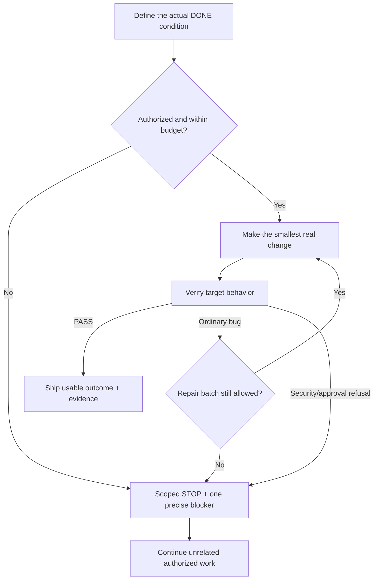

# I Have No Patience ⚡

### Stop burning tokens. Stop reviewing reviews. Ship the damn task.

**An open-source Agent Skill + optional budget-guard CLI for Hermes, Claude Code, Codex, OpenCode, and other tool-using agents.**

**[繁體中文 README](README.zh-TW.md)** · [Install](#quick-start) · [Actual case study](skills/i-have-no-patience/references/CASE_STUDY.md) · [Enforcement vs. promises](skills/i-have-no-patience/references/ENFORCEMENT.md)

> **One brutal question:** *Did the thing actually run?*
>
> If all you have is an approval request, 40 passing mock tests and a ZIP file, the answer is probably **no**.

---

## Why this exists (a real story)

I spent **weeks** trying to make a local AI system autonomously run tasks. I had Hermes, coding agents, local models, cloud models, skills, a harness and a serious set of safety controls.

I wanted a simple end-to-end result:

**Find a task → do the work → test it → report what changed → take the next authorized task.**

Instead, I got a factory for *proof that something might work someday*.

- A few hundred artifacts became ZIP archives containing **995, then 998 files**, all beautifully hashed.
- One round passed **25/25 guard checks**. Another passed **12/12 control checks**. A later Windows staging check reported **348/348 read/execute successes and 2,447/2,447 write/access denials**.
- We investigated rollback journals, Windows AccessCheck, private desktops, restricted tokens, Job Objects, SQLite WAL/SHM generations, handle identities, symlinks, UAC, and signoff certificates.
- Each fixed problem uncovered another precondition. Each precondition generated another report. Each report prompted another review.
- **The native autonomous coding worker was still not proven running.** The central goal was unfinished.

Eventually I was furious. Not because safety mattered — safety was necessary — but because **we had confused building the safety system with delivering any useful autonomous behavior at all.**

The honest status was `LEDGER_GATE_L_NOT_PASSED / NATIVE_GATE_BLOCKED / TOCTOU_BLOCKED`. It was *not* “success.”

That experience became **I Have No Patience**. The goal isn't to be rude to your AI. It's to make work measurable, time-bound, scoped, and impossible to pass off as done without evidence.

Read the longer [postmortem](skills/i-have-no-patience/references/CASE_STUDY.md). These numbers describe historical receipts provided during development, **not** a benchmark reproduced by this repository.

## What changes when you use it?

| Without this Skill | With this Skill |
|---|---|
| “I have a detailed implementation plan…” | Defines the observable DONE condition, then acts |
| “37 unit tests passed, therefore deployed” | Separates `TESTED_LOCAL`, `TESTED_TARGET` and `RUNNING` |
| “The security gate failed, so nothing can happen” | Blocks that operation; continues unrelated authorized tasks |
| “One more independent review?” | Stops infinite approval loops; requests a narrowly scoped missing approval |
| 12 near-identical provider calls | Request deduplication + per-task call ceiling **if** the broker is wired |
| Unclear cost, no budget settlement | Pre-call reserve, post-call usage accounting, conservative unknown-usage charging |
| Safety refusal? Try another provider | Preserves refusal and STOP; does **not** launder via fallback |

**This table is a behavior contract, not proof of end-to-end deployment in every agent.** The Skill supplies instructions; hard controls require actual model-router integration.

## Observed after installation: evidence, not a success story

[Read the before/after evidence report (繁體中文)](docs/VERIFIED_PROGRESS.zh-TW.md), including the [machine-readable facts](docs/evidence/comparison-facts.json).

- **Actual loading:** five installed files match the original SHA-256 manifest. A retained `skill_view` event returned the complete instructions; normalizing only the expanded local path reproduces this repository's `SKILL.md` exactly. [Loading receipt](docs/evidence/skill-load-receipt.json).
- **Local outcome:** 18/18 Budget Guard tests passed after loading and again before publication. [Raw test output](docs/evidence/tests-publication-check.txt).
- **Chronological operational progress:** an existing research lane advanced from two manual runs to those same two plus 13 built-in scheduled runs, with 15 retained reports and scheduler-recorded deliveries by October 25, 2026, 08:38 UTC+08:00. [Per-run evidence](docs/evidence/research-run-index.json).
- **No causal shortcut:** that separate cron job has `skills: []`; there is no proof its model contexts loaded this Skill. Several topics repeat. Fifteen reports are **not** fifteen independently accepted unique tasks, nor proof the Skill caused a productivity gain.
- **Still unproven:** native autonomous coding, non-bypassable model-router enforcement, and token/cost savings. Security boundaries were not relaxed for this publication.

## The operating principle



We don't remove safety gates. We stop turning every safety gate into a universal excuse for doing no work.

## Quick start

### Option A: Hermes (manual install, no account needed)

Clone/download this repo and copy the skill folder into Hermes's skill directory:

**Windows PowerShell**

```powershell
New-Item -ItemType Directory -Force "$HOME\.hermes\skills\i-have-no-patience" | Out-Null
Copy-Item ".\skills\i-have-no-patience\*" "$HOME\.hermes\skills\i-have-no-patience" -Recurse -Force
hermes skills list
```

**Linux / macOS**

```bash
mkdir -p ~/.hermes/skills
cp -R skills/i-have-no-patience ~/.hermes/skills/
hermes skills list
```

Activate in Hermes:

```text
/i-have-no-patience

Finish the already-authorized task. Prove the result in the target environment.
No fake DONE, no review loops, no extra token spending without progress.
Keep all security and human approval boundaries.
```

Hermes also supports publishing a **Skill tap**: after this repo is published on GitHub, others can use `hermes skills tap add <owner>/<repo>` and install the named skill using the Hermes skill commands shown in the CLI. We intentionally do not invent a future GitHub URL. [Hermes skills docs](https://hermes-agent.nousresearch.com/docs/user-guide/features/skills).

### Option B: Other tool-using agents

The `skills/i-have-no-patience/SKILL.md` frontmatter follows the [Agent Skills spec](https://agentskills.io/specification). Put that directory in your agent's supported skills folder or add its content to an authorized project-level instruction file. Tool availability and invocation differ across agents; this repo does not silently install itself elsewhere.

### Option C: Run the budget guard demo

Requires Python 3.10+ (standard library only). From repo root:

```bash
python -m unittest discover -s tests -v
python skills/i-have-no-patience/scripts/budget_guard.py --help
```

The budget guard provides `task`, `reserve`, `settle`, `block`, and `status` operations; see [working examples and integration contract](skills/i-have-no-patience/references/ENFORCEMENT.md).

Example Owner-controlled defaults (you must choose your own budget):

```json
{
  "schema": "i-have-no-patience/v1",
  "task_token_budget": 12000,
  "model_calls_per_task": 6,
  "no_progress_limit": 2,
  "max_tokens_per_call": 5000
}
```

**Important:** Those limits are only enforced for calls that pass through a **trusted, non-bypassable** provider adapter. Merely loading `SKILL.md` does not cap your paid subscriptions, API bills or native model usage. The real integration must validate prompt tokens, constrain output tokens, record provider usage, protect the state file, and block alternate paths. [Read this before claiming a hard cap](skills/i-have-no-patience/references/ENFORCEMENT.md).

## Zero tolerance for fake progress

Each task should produce a small, honest status:

```text
DONE: NOT_DONE — live worker not running
PROOF: runtime permission checks passed; no actual child execution receipt
BLOCKER: restricted child startup boundary not qualified
NEXT: one authorized startup test; no production deployment
```

**NOT_DONE is not failure of honesty. Calling NOT_DONE “DEPLOYED” is.**

## What it doesn't do

- ❌ It does not give an LLM Windows admin privileges or override UAC, ACL, human review or STOP flags.
- ❌ It does not bypass provider refusals by changing models or prompts.
- ❌ It does not magically enforce budgets across all models: **only a trusted integrated router can**.
- ❌ It does not promise every task will finish, or that reviewers are unnecessary.
- ❌ It does not claim the motivating native Harness was fixed by writing this Skill.

## Repository contents

```text
i-have-no-patience/
├── README.md                  # The origin story + quick start
├── README.zh-TW.md            # 繁體中文版本
├── skills/
│   └── i-have-no-patience/
│       ├── SKILL.md           # Short, on-demand skill instructions
│       ├── scripts/
│       │   └── budget_guard.py # Offline stdlib cooperative budget ledger
│       ├── config/
│       │   └── policy.example.json
│       └── references/
│           ├── CASE_STUDY.md  # Detailed real-world lessons
│           └── ENFORCEMENT.md # Hard limits require trusted call routing
├── tests/                    # Runnable negative and positive cases
├── examples/                 # Integration example
└── .github/workflows/ci.yml  # Python test matrix
```

## Who it's for

Anyone whose agent is brilliant at *looking busy*: coders, research agents, CI workers, multi-agent orchestration, local model stacks, and the person paying the model bill.

If this resonates, please ⭐ **star the repo after trying it**, open an issue with a reproducible loop, and send a PR with a real fix. We prefer one tested improvement over twenty ideas. See [CONTRIBUTING.md](CONTRIBUTING.md).

## Security & status

- **Tested here:** pure Python guard unit tests; no special Windows privileges and no model API traffic.
- **Not tested here:** a non-bypassable Hermes gateway integration, real provider billing protection, Windows production deployment.
- **License:** MIT.
- **Security disclosures:** [SECURITY.md](SECURITY.md).

**The only metric that matters: fewer tokens wasted per *verified user outcome*. Not fewer tokens per report.**
